## Operaciones basicas con OpenCV 
## Alumno: Meredith Aguirre NC = 0013
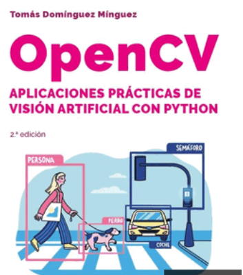
## 1. LECTURA DE LA IMAGEN DESDE LA CARPETA LOCAL
### Cuando no pueda cargar la imagén
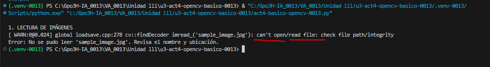
#### Cuando puede leer imagén
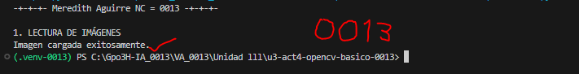
## 2. PROPIEDADES DE LA IMAGEN
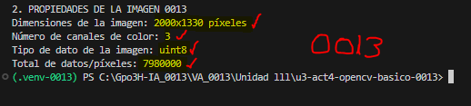
## 3. VISUALIZACIÓN DE LA IMAGEN ORIGINAL

## En la terminal
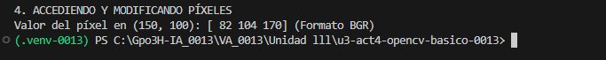
## 4. ACCESO Y MODIFICACIÓN DE PÍXELES INDIVIDUALES
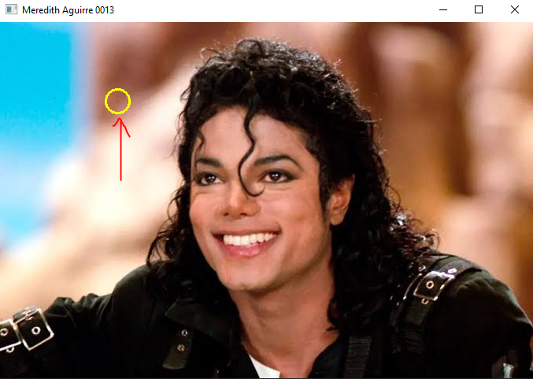
## 5. REGIÓN DE INTERÉS (ROI - REGION OF INTEREST)
## Imagen con ROI marcada
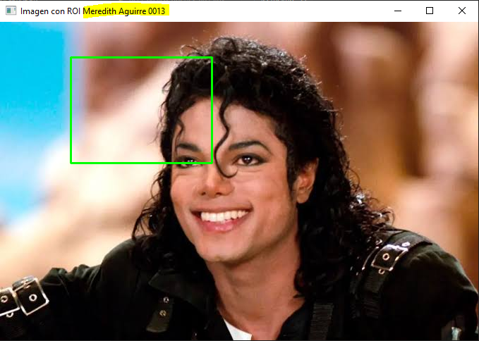
## ROI Extraida (Recorte)
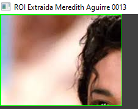
## 6. SEPARACIÓN Y FUSIÓN DE CANALES DE COLOR (BGR)
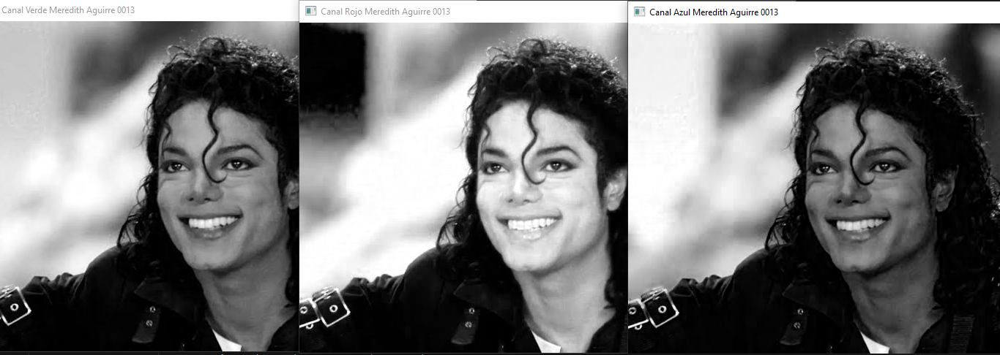
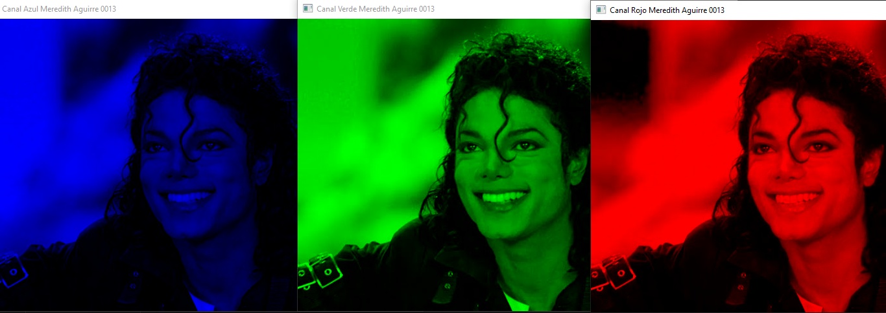
## 7. REDIMENSIONAMIENTO DE IMÁGENES (RESIZING)
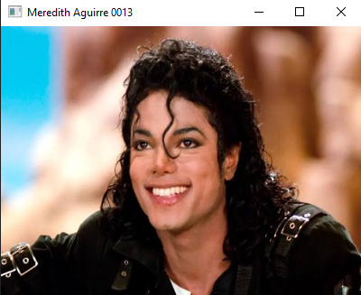
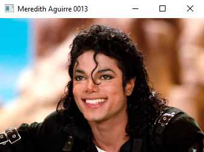

## 8. ROTANDO IMÁGENES
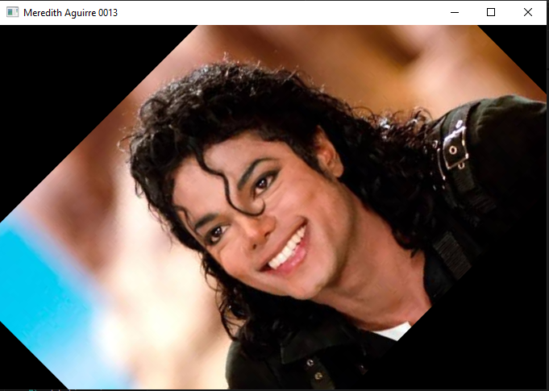
## 9. VOLTEANDO IMÁGENES

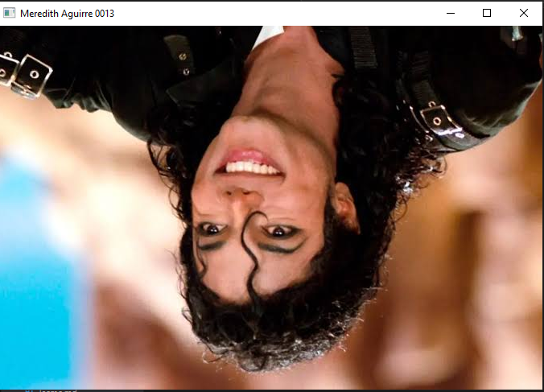
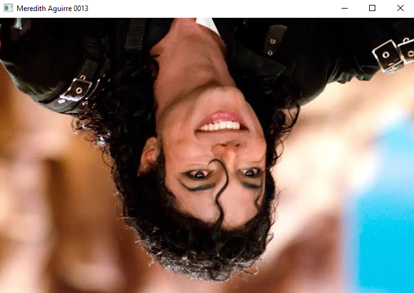